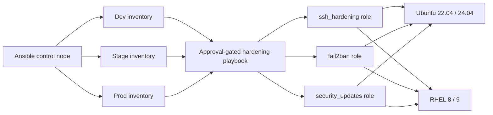

# Coding Clinic — Lab 2: Enterprise Linux Security Hardening with Ansible

Reusable Ansible automation for applying a limited, CIS-aligned Linux security baseline to Ubuntu and Red Hat Enterprise Linux hosts. This is a code-only project: it has not connected to EC2 or modified any server.

## Problem statement

Create a reusable Ansible playbook and roles to harden Ubuntu 22.04/24.04 and RHEL 8/9 hosts by disabling direct root SSH, configuring Fail2ban, scheduling security updates, and enforcing strong SSH settings. The project includes environment-specific configuration for dev, stage, and prod, offline tests, and validation-only CI. It does not provision AWS infrastructure or require AWS credentials.

## Architecture

This is the intended future architecture, not a deployed environment. The inventories contain reserved TEST-NET documentation addresses only.



## Repository layout

- `ansible-linux-hardening/roles/`: reusable SSH, Fail2ban, and security-update roles, including Ubuntu/RHEL tasks, templates, defaults, and handlers.
- `ansible-linux-hardening/playbooks/harden-linux.yml`: orchestration, OS checks, and a default-deny approval gate that runs on the control node before host connections.
- `ansible-linux-hardening/inventories/{dev,stage,prod}/`: static, non-routable sample inventories and environment-specific group variables.
- `ansible-linux-hardening/examples/`: sample inventory and override variables.
- `ansible-linux-hardening/tests/`: offline YAML, template, policy-default, and structure tests.
- `.github/workflows/ansible-ci.yml`: repository-level validation workflow.
- The [detailed Lab 2 README](ansible-linux-hardening/README.md) documents role inputs, OS differences, troubleshooting, CIS scope, and operational tradeoffs.

## Prerequisites

For local static validation, use Python 3.10+, Ansible Core 2.16–2.19, ansible-lint 24.10–25.x, yamllint 1.x, and pytest 8 or 9. No AWS CLI, AWS credentials, SSH keys, containers, or live hosts are required for the offline tests. Optional service-level tests would require disposable systemd-capable Ubuntu/RHEL VMs; none are included or claimed here.

Install tools from the project directory:

```bash
cd ansible-linux-hardening
python -m venv .venv
source .venv/bin/activate
python -m pip install -r requirements-dev.txt
```

On Windows PowerShell, activate with `.venv\Scripts\Activate.ps1`.

## Configuration and usage

The inventories use reserved TEST-NET IPs such as `192.0.2.10` and `198.51.100.10`; they are examples, not real hosts. Environment policies live under each inventory's `group_vars/linux.yml`. The SSH connection user must match `ssh_hardening_admin_user`.

Syntax-check without connecting to a host:

```bash
cd ansible-linux-hardening
ansible-playbook -i inventories/dev/hosts.yml playbooks/harden-linux.yml --syntax-check
```

The key defaults preserve access and avoid unexpected reboots:

```yaml
hardening_approved: false
ssh_hardening_password_authentication: true
ssh_hardening_key_access_verified: false
fail2ban_enabled: true
fail2ban_rhel_repository_ready: false
security_updates_enabled: true
security_updates_security_only: true
security_updates_auto_reboot: false
security_updates_schedule: daily
```

Disabling password SSH requires a non-root admin connection, an existing `authorized_keys` file, and an explicit operator attestation that key access was tested from a second session. On RHEL, Fail2ban requires an organization-approved package source; the role does not enable EPEL. A future authorized run must use a reviewed real inventory and narrow host limit; set `hardening_approved=true` only for that approved change. No such execution was performed for this lab.

## Security and idempotency

SSH root login is disabled; the managed drop-in rejects empty passwords, enables public-key authentication, limits retries and grace time, and disables X11/TCP forwarding by default. SSH configuration is checked with `sshd -t` and inspected with `sshd -T -C` before a change-triggered reload. Password authentication remains configurable and enabled by default to avoid locking out administrators whose key access has not been verified. RHEL crypto-policy defaults are respected.

Fail2ban uses the systemd journal backend, loopback-only trusted-IP defaults, configurable retry/ban windows, and a managed jail file. It does not edit host firewall rules; coordinate Fail2ban with host firewalls and AWS Security Groups so approved management access remains available. Ubuntu uses `unattended-upgrades` security origins; RHEL uses security-only `dnf-automatic` and a single managed install timer. Automatic reboots are off by default. Production patching still needs maintenance windows, canaries, compatibility checks, monitoring, backups, and rollback planning.

Roles use declarative package, file, template, and service modules; handlers run only for changed configuration; read-only validation commands report `changed_when: false`. The configuration is designed to be idempotent, but no second-run or live-host idempotency test has been performed. This is a limited CIS-aligned subset, not a claim of full CIS compliance.

## Tests and CI

From `ansible-linux-hardening/`, run:

```bash
yamllint . ../.github/workflows/ansible-ci.yml
ansible-lint
ansible-playbook -i inventories/dev/hosts.yml playbooks/harden-linux.yml --syntax-check
pytest
```

The tests parse YAML, inspect secure defaults, and render SSH/Fail2ban/APT/DNF templates. They do not install packages, apply patches, reload services, connect to hosts, or require AWS credentials. The GitHub Actions workflow runs those lint, syntax, and pytest checks on pull requests and pushes to `main`; it has read-only repository permissions and no AWS authentication or deployment steps.

In this local environment, Python, Ansible, ansible-lint, yamllint, and pytest are unavailable, so these commands have not been run here. No EC2 instances were provisioned, no live servers were changed, and the repository has not been pushed.
