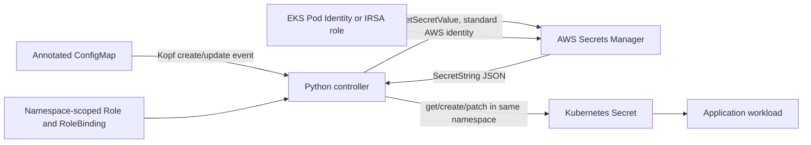

# Python Kubernetes Secret Sync Controller

This code-only lab implements a small Kopf controller that watches annotated ConfigMaps, reads a JSON string secret from AWS Secrets Manager, and creates or updates an owned Kubernetes Secret in the same namespace. It uses Boto3's standard AWS credential chain and the Kubernetes Python client.

The project has not been deployed. Tests use mocked AWS and Kubernetes clients; no real credentials or secret values are used.

## Original Code Clinic problem

> Develop a Python Kubernetes operator (or controller) that watches for ConfigMaps with a specific annotation and automatically creates corresponding Kubernetes Secrets from AWS Secrets Manager / Azure Key Vault.

This implementation uses AWS Secrets Manager as the initial provider and does not include Azure Key Vault.

## Enterprise business scenario

Applications often consume credentials from Kubernetes Secrets while the organization treats AWS Secrets Manager as the source of truth. Manually copying secret values creates drift and exposes values to extra operators. This controller automates the transfer for explicitly opted-in ConfigMaps, checks ownership before modifying a Secret, and skips writes when the current values match.

## Architecture



The ConfigMap contains only an AWS secret reference and the target Kubernetes Secret name. Secret values do not pass through ConfigMap data.

## Repository structure

```text
k8s-secret-sync-controller/
├── controller.py
├── requirements.txt
├── examples/configmap.yaml
├── deploy/
│   ├── deployment.yaml
│   ├── serviceaccount.yaml
│   └── rbac.yaml
├── tests/test_controller.py
├── README.md
├── LICENSE
└── .gitignore
```

CI is kept in the repository's single root workflow folder at `../.github/workflows/ci.yml`.

## Prerequisites

- Python 3.11 or newer.
- pip for installing the project dependencies.
- AWS credentials and a Kubernetes cluster are **not** needed for tests.
- A real deployment would require a pre-created target namespace, an image built and published separately, AWS workload identity, and the RBAC manifests reviewed for that namespace.

## How the controller works

Kopf registers create and update handlers for core-v1 ConfigMaps. An event is ignored unless `secret-sync.example.com/enabled` is set to `"true"`. For updates, the handler only reconciles when one of its three synchronization annotations changes; this prevents unrelated ConfigMap edits and Kopf's own progress annotations from triggering another AWS lookup.

For an opted-in ConfigMap, the controller:

1. Validates the AWS secret reference and target Secret name.
2. Reads the target Secret in the ConfigMap's namespace.
3. Refuses to continue if an existing Secret lacks the controller and source-ConfigMap ownership annotations.
4. Calls AWS Secrets Manager `GetSecretValue` using Boto3's standard credential provider chain.
5. Validates that `SecretString` is a non-empty JSON object whose keys are valid Secret data keys and whose values are strings.
6. Creates the Secret if it does not exist, updates it if decoded data differs, or skips the write when it is unchanged.

The Kubernetes API receives values through the Secret `stringData` field. The API stores the Secret's data encoded for transport; base64 encoding is not encryption. The controller decodes the existing `data` only in memory to compare it with the AWS value.

Invalid annotations, invalid payloads, missing AWS secrets, access denied errors, and unmanaged Secrets are reported as permanent configuration/security errors. AWS connectivity and retryable Kubernetes API errors use Kopf temporary errors with retry. Error messages and logs do not contain secret values.

Deleting or disabling a ConfigMap does not delete the Kubernetes Secret.

## ConfigMap annotations

The required annotations are:

| Annotation | Purpose |
| --- | --- |
| `secret-sync.example.com/enabled` | Must be `"true"` to opt in |
| `secret-sync.example.com/aws-secret-name` | AWS Secrets Manager secret name or ARN |
| `secret-sync.example.com/target-secret-name` | Secret name to create or update in the same namespace |

See [examples/configmap.yaml](examples/configmap.yaml). Its identifiers and non-sensitive data are synthetic. Do not put passwords, tokens, or secret values in ConfigMap annotations or data.

The target name must be a valid Kubernetes DNS subdomain. The controller requires the ConfigMap to have a name and namespace.

## AWS Secrets Manager integration

This first version supports only `SecretString` containing a JSON object of string values, for example:

```json
{
  "DB_USERNAME": "example-user",
  "DB_PASSWORD": "example-password"
}
```

The values above are examples only. Binary secrets, nested values, numbers, booleans, empty objects, and invalid Secret data keys are rejected.

The controller does not accept access keys from ConfigMaps or environment variables in its code. Boto3 uses its standard credential chain. For a real EKS deployment, associate a narrowly scoped IAM role through EKS Pod Identity or IRSA. Restrict `secretsmanager:GetSecretValue` to the approved secret ARN and add `kms:Decrypt` only when the secret uses a customer-managed KMS key and the role needs that permission.

Example least-privilege policy shape; replace the placeholder with the approved ARN before a real deployment:

```json
{
  "Version": "2012-10-17",
  "Statement": [
    {
      "Effect": "Allow",
      "Action": ["secretsmanager:GetSecretValue"],
      "Resource": "REPLACE_WITH_APPROVED_SECRET_ARN"
    }
  ]
}
```

The region is configured with `AWS_REGION` (or `AWS_DEFAULT_REGION`). The deployment manifest contains a placeholder region that must be replaced for a real deployment.

## Kubernetes Secret ownership and reconciliation

New Secrets use type `Opaque`, the ConfigMap namespace, and ownership annotations identifying this controller and the source ConfigMap. On future events, the controller modifies only a Secret with both matching ownership annotations. Existing unmanaged Secrets, or Secrets owned by a different ConfigMap, are left untouched and reported as an error.

Kubernetes Secrets are not inherently encrypted because their values are base64 encoded. Enable Kubernetes encryption at rest, tightly restrict Secret reads, protect audit logs, and use an approved secret delivery design for the cluster.

## Local installation and offline tests

From this project directory:

```bash
python -m pip install -r requirements.txt
ruff check .
pytest -v
```

The test suite injects fake Boto3 and Kubernetes clients. It does not authenticate, connect to AWS, contact a cluster, retrieve real secrets, or create Kubernetes resources. Installing Python packages may require access to your configured package index; test execution itself makes no external service calls.

The CI workflow also parses all project YAML files and its own workflow with PyYAML.

## Deployment prerequisites

The files in `deploy/` are examples only and are not applied by this lab. Before any real deployment:

- Create the target namespace through the platform's approved process; these manifests use `demo`.
- Build and publish the controller image separately, then replace the placeholder image.
- Configure EKS Pod Identity or IRSA for the workload and scope AWS permissions to approved secret ARNs.
- Review the Role and RoleBinding. They are namespace-scoped; ConfigMap patch permission lets Kopf persist handler progress annotations, Secret permissions are limited to get/create/patch, and event creation supports Kopf's Kubernetes event reporting.
- Verify encryption at rest and restrict which principals can read Secrets.

The controller is configured for one namespace and one replica using Kopf standalone mode. No cluster-wide RBAC or public Service/Ingress is included. This README explains deployment prerequisites but does not provide or run deployment commands.

## GitHub Actions CI

The monorepo keeps a single workflow in the root `.github/workflows/` directory. Its Problem 12 job runs on pull requests and pushes to `main` when this project or the workflow changes. CI installs Python 3.11 dependencies, runs Ruff, runs the offline pytest suite, and parses YAML. Permissions are `contents: read`; CI does not authenticate to AWS or Kubernetes, build an image, or deploy.

## Security considerations

- Treat AWS Secrets Manager as the source of truth. ConfigMaps carry references only.
- Use EKS Pod Identity or IRSA for real AWS access; do not configure long-lived keys in the image or manifests.
- Scope IAM to approved Secrets Manager ARNs and scope Kubernetes RBAC to the controller namespace.
- Enable encryption at rest for Kubernetes Secrets and tightly limit read permissions.
- The controller never logs AWS payloads, Secret data, or exception response bodies.
- Ownership checks prevent overwriting Secrets that this ConfigMap did not create.
- The pod uses a dedicated ServiceAccount, non-root UID, read-only root filesystem, dropped capabilities, no privilege escalation, and RuntimeDefault seccomp.
- Protect production ConfigMap annotations and deployment changes with review and audit controls.
- Secret synchronization does not replace cluster admission controls, network security, workload identity policy, monitoring, or incident response.

## Idempotency and rotation behavior

The same ConfigMap event and same AWS value result in no Kubernetes write when the owned Secret is already current. A changed AWS value is written only on a subsequent relevant ConfigMap create/update event. Kopf's progress annotations are ignored by the update filter, preventing self-triggered reconciliation loops.

This controller does **not** continuously detect AWS Secrets Manager rotations. Changing a secret in AWS alone does not generate a Kubernetes ConfigMap event. A later relevant ConfigMap event is required to reconcile it. Even after Kubernetes Secret data changes, an application reading the value through an environment variable will not see the new value until its pod restarts. Plan secret rotation and workload restart behavior accordingly.

## Limitations and future improvements

- AWS Secrets Manager is the only provider; Azure Key Vault and other providers are out of scope.
- Only JSON string payloads in `SecretString` are supported; binary and nested values are rejected.
- The controller is namespace-scoped and runs as one standalone replica.
- AWS rotations do not trigger reconciliation automatically.
- ConfigMap deletion or opt-out does not delete the generated Secret.
- The placeholder container image is not built or published, and no cluster deployment has been tested.
- Kopf may add progress annotations to handled ConfigMaps, which is why its Role includes ConfigMap patch permission. Its Role also allows creating namespaced Kubernetes Events for handler reporting.

Future work could add an explicit, separately reviewed rotation trigger, application rollout coordination, metrics, and tests against a disposable local Kubernetes cluster. Those capabilities are not part of this code-only lab.

This project has not been deployed to a Kubernetes cluster, has not accessed AWS, and has not retrieved or created any real secrets.

