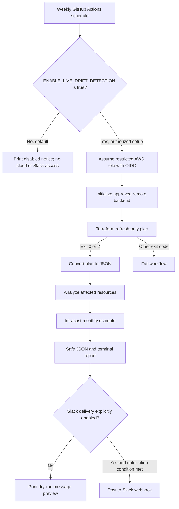

# Automated Terraform Drift Detection and Cost Monitoring

This code-only lab demonstrates a scheduled GitHub Actions pipeline for Terraform refresh-only drift detection, an independent Infracost monthly estimate, and an optional Slack notification. The scheduled workflow is disabled by default. The lab has not authenticated to a cloud provider, accessed real Terraform state, or sent Slack messages.

## Original assignment

> Create a CircleCI or GitHub Actions pipeline that runs infrastructure drift detection (Terraform plan + Infracost) on a schedule and posts results to Slack/Teams.

This implementation uses GitHub Actions and Slack Incoming Webhooks.

## Business problem

Manual changes made outside Terraform can cause state and remote infrastructure to diverge. A periodic refresh-only plan can identify certain remote-object differences from recorded state, while a cost estimator can report an estimate for the configured Terraform resources. A concise report gives operators a review starting point without automatically changing infrastructure.

## Architecture



The enabled path is a future operational capability, not a deployed environment. The validation workflow uses only synthetic files and does not run this scheduled workflow.

## Repository structure

```text
terraform-drift-cost-monitor/
├── terraform/
│   ├── main.tf
│   ├── variables.tf
│   └── outputs.tf
├── scripts/
│   ├── analyze.py
│   └── notify_slack.py
├── config/settings.example.json
├── examples/
│   ├── no-drift-plan.json
│   ├── drift-plan.json
│   └── infracost-example.json
├── tests/
│   ├── test_analyze.py
│   └── test_notify.py
├── README.md
├── LICENSE
└── .gitignore
```

This lab follows the monorepo's single workflow folder: the CI job is in [`../.github/workflows/ci.yml`](../.github/workflows/ci.yml), and the scheduled workflow is [`../.github/workflows/drift-detection.yml`](../.github/workflows/drift-detection.yml). No workflow files are nested in this project directory.

## How drift detection works

Terraform's `plan -refresh-only` compares remote object observations with Terraform's recorded state and prepares a plan to update state observations. It does not compare the configuration to the live resource in the same way as a normal plan, and it does not by itself prove the resource still matches the desired configuration. Review the plan before any state update; this lab never runs `terraform apply` or `apply -refresh-only`.

With `-detailed-exitcode`, Terraform returns `0` when the plan is empty, `2` when changes are present, and `1` for an error. The scheduled workflow explicitly treats `0` and `2` as successful planning outcomes and fails on other exit codes. It never hides errors with `continue-on-error`.

`analyze.py` reads plan JSON and uses the `resource_drift` entries when present, falling back to `resource_changes` for older or synthetic inputs. It reports addresses and actions only; it does not include before/after attribute values. Reports and Slack messages include an environment and run ID so repeated scheduled notifications can be distinguished. Malformed inputs and Terraform plans marked errored produce an error status and nonzero exit code.

## Infracost and cost interpretation

Infracost estimates the monthly cost of the Terraform configuration. The report displays that amount separately from drift and always uses `N/A` for drift cost impact because a refresh-only drift plan is not a reliable estimate of the financial impact of out-of-band changes. A cost estimate is not an actual cloud bill or a promise of savings. Offline examples use synthetic cost data and no pricing API.

The live workflow requires an `INFRACOST_API_KEY` GitHub Environment secret. When enabled, the Infracost CLI may send resource configuration details to its pricing service; review organizational data handling requirements before enabling it.

## Slack notification behavior

`notify_slack.py` formats a concise message with environment, drift status, changed-resource count, estimate, and review status. Its default behavior is dry-run: it prints a preview and performs no network request. Delivery requires the explicit `--send` option and `SLACK_WEBHOOK_URL`. The workflow also requires the separate `ENABLE_SLACK_NOTIFICATIONS=true` variable, and by default sends only when drift is detected. `NOTIFICATION_ON_NO_DRIFT=true` can explicitly allow no-drift notifications. The webhook URL belongs in a GitHub Environment secret, never in source code or logs.

## Configuration

`config/settings.example.json` documents safe defaults:

```json
{
  "environment": "dev",
  "drift_detection_enabled": false,
  "slack_notifications_enabled": false,
  "notification_on_no_drift": false
}
```

The schedule workflow does not read or create these GitHub settings automatically. Live execution requires the repository variable `ENABLE_LIVE_DRIFT_DETECTION=true`. The GitHub Environment named `drift-detection` must be created and protected separately, with required approvals and these variables:

- `AWS_ROLE_ARN`, `AWS_REGION`
- `TF_STATE_BUCKET`, `TF_STATE_KEY`, `TF_STATE_REGION`
- `DRIFT_MONITORED_BUCKET`, `DRIFT_ENVIRONMENT` (`dev`, `stage`, or `prod`)
- Optional `ENABLE_SLACK_NOTIFICATIONS=true` and `NOTIFICATION_ON_NO_DRIFT=true`

Secrets for the environment are `INFRACOST_API_KEY` and, only if Slack delivery is enabled, `SLACK_WEBHOOK_URL`. These are documentation requirements, not values configured by this lab.

## Terraform example and live prerequisites

`terraform/` contains a small AWS S3 bucket example with no credentials, account IDs, or real backend settings. CI initializes it with `-backend=false`, so validation does not access any remote state. The example bucket name is a placeholder and is not applied.

Real drift checks would require an existing Terraform-managed environment, matching configuration and state, an approved remote backend, read-only AWS permissions for the managed resources, narrowly scoped backend state/lock access, a protected GitHub Environment, and a trusted runner. The AWS role should trust only the repository's protected branch/environment through GitHub OIDC. Do not give the role resource write permissions. Backend locking can require write/delete access to the lock object even when the resource permissions are read-only. Configure these controls outside this lab.

## Local offline demonstration

From this project directory:

```bash
python scripts/analyze.py \
  --plan examples/drift-plan.json \
  --cost examples/infracost-example.json \
  --environment dev

python scripts/notify_slack.py \
  --report report.json \
  --dry-run

python -m unittest discover -s tests -v
```

The analyzer writes `report.json` by default. Use `--output path.json` to choose a different local report path. Try `examples/no-drift-plan.json` for the no-drift case. Tests use only synthetic files and mocked webhook delivery; they do not need AWS credentials, a Terraform backend, Infracost credentials, or Slack access.

## GitHub Actions workflows

The repository's one `.github/workflows` folder contains:

- `ci.yml`: runs on pull requests and pushes to `main`; performs Python syntax checks, offline unit tests, Terraform formatting and validation with backend initialization disabled, fixture analysis, and Slack dry-run tests. Permissions are `contents: read`.
- `drift-detection.yml`: scheduled weekly on Monday at 08:00 UTC and manually dispatchable. When the enablement variable is absent or false, it only prints that live detection is disabled. The live job requests `id-token: write` only after explicit enablement and uses OIDC rather than static cloud keys. No backend, AWS role, secret, or environment approval is provisioned here.

When an administrator explicitly enables the live workflow, it initializes only the approved backend, runs a refresh-only plan, analyzes JSON output, generates the Infracost estimate, and optionally sends Slack. It never runs apply or destroy. It does not upload plan files as artifacts.

## Security

- No AWS credentials, cloud account IDs, state files, or real Terraform plans are committed.
- CI has read-only repository permission and uses `terraform init -backend=false`; it does not contact AWS.
- The scheduled job is disabled unless the repository variable is explicitly set. Its live job uses short-lived OIDC credentials and a separately protected GitHub Environment.
- Restrict the AWS role to read-only access on managed resources and the minimum remote-state access. The S3 backend may also need narrowly scoped permissions on its state lock object. Restrict OIDC trust to the protected repository branch and environment.
- Store the Infracost API key and Slack webhook in GitHub Environment secrets. Do not echo them or put them in Terraform files.
- Terraform plan JSON can contain sensitive values. The live workflow keeps plan files in the runner's temporary directory, does not upload them, excludes values from reports, and removes temporary files at the end of the job.
- Slack delivery is opt-in at both the workflow variable and script flag. Dry-run performs no network request.
- No automatic remediation, `terraform apply`, `terraform destroy`, or state-writing refresh-only apply is used.

## Idempotency and limitations

Repeated analysis of identical plan and cost JSON produces the same report. The scripts do not modify infrastructure or Terraform state. A scheduled run can notify repeatedly about unresolved drift. Cost data is a configuration estimate, not observed billing, and drift cost impact remains `N/A` unless a separately reviewed method can calculate it reliably.

This lab does not access a real backend, validate IAM policies, verify actual Slack delivery, or guarantee complete drift detection for every provider/resource behavior. The sample backend is intentionally unconfigured and the sample S3 bucket is not created.

## Future improvements

Possible follow-up work includes reviewed per-environment state configuration, policy checks over drift reports, richer cost baselines, and organization-specific retention controls for sensitive plans. Any live integration should remain separately approved and least-privileged.
