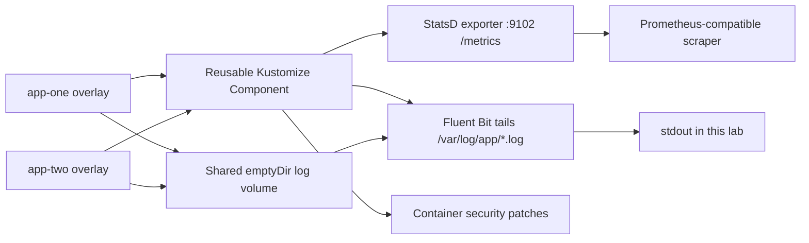

# Code Clinic Problem 14: Reusable Kustomize Observability and Security Component

## Project overview

This code-only lab builds a reusable Kustomize Component that adds a Prometheus-compatible metrics exporter, a Fluent Bit file-log collector, scrape annotations, and baseline container hardening to compatible Kubernetes Deployments. Two sample applications consume the same component. No Kubernetes resources, cloud resources, or container images were deployed, built, or published.

## Original problem statement

> Build a reusable Kustomize component or Helm library chart that injects standard observability sidecars (Prometheus, Fluent Bit) and security contexts.

This implementation uses Kustomize Components, as requested. Prometheus itself is a scraper, so the metrics sidecar is `statsd_exporter`, which accepts StatsD packets over UDP 9125 and exposes exporter and received StatsD metrics as Prometheus text at port 9102, path `/metrics`. It does not discover application business metrics by itself; applications must emit StatsD metrics to the pod-local endpoint for those metrics to appear.

## Enterprise problem and architecture

Teams often copy sidecars, annotations, and security policy into every application manifest. Copies drift and need repeated edits. This component centralizes those defaults while making the application contract explicit.



The component targets Deployments labeled `observability.example.com/enabled: "true"`. It expects the primary application container to be at index zero, an existing `volumeMounts` list on that container, and existing pod-template `annotations` and `volumes` fields. It appends its sidecars after the primary container and injects a named log volume. This predictable contract avoids targeting app-specific Deployment names.

## Repository structure

```text
.
├── .github/workflows/ci.yml
├── README.md
└── kustomize-observability-component/
    ├── components/observability/
    ├── examples/app-one/
    ├── examples/app-two/
    ├── scripts/validate.sh
    └── tests/test_render.py
```

There is one repository README and one repository-level workflow.

## Prerequisites

- Kustomize 5.x, or `kubectl` with `kubectl kustomize` support for Components.
- Python 3.10 or later for the standard-library test runner.
- Bash to run `scripts/validate.sh`.

No cluster is required. The examples use public images and synthetic logs; rendering and tests do not pull images.

## Component details

- **Metrics:** `prom/statsd-exporter:v0.31.0`; listens on UDP 9125 for StatsD, serves Prometheus metrics on TCP 9102 at `/metrics`. Scrape annotations point to that endpoint. The annotations are a common convention; your Prometheus discovery configuration must honor them.
- **Logging:** `cr.fluentbit.io/fluent/fluent-bit:5.1.5` tails only `/var/log/app/*.log` from a dedicated shared `emptyDir`, then writes processed records to its own stdout. It does not tail node logs or its own output, so there is no recursive collection. A real deployment can replace the stdout output with an authenticated destination and managed credentials.
- **Security:** the component sets `runAsNonRoot`, disables privilege escalation, drops all Linux capabilities, and requests `RuntimeDefault` seccomp on the application container. Sidecars have equivalent hardening. The examples set an explicit non-root UID/GID for their BusyBox process; Fluent Bit also runs with an explicit UID/GID. Exporter uses the non-root identity configured by its pinned image.
- **Resources:** all sample and sidecar containers have CPU and memory requests and limits.
- **Storage:** `emptyDir` is pod-scoped, ephemeral storage. No `hostPath` or node-level log access is used.

The StatsD exporter exposes its own process/runtime metrics and metrics it receives and translates. It does not create application-specific metrics automatically. See the [StatsD exporter documentation](https://github.com/prometheus/statsd_exporter) and [release history](https://github.com/prometheus/statsd_exporter/releases). Fluent Bit's container distribution and configuration are documented in its [official documentation](https://docs.fluentbit.io/manual/installation/docker).

## Example use

Each sample `kustomization.yaml` references `../../components/observability`; it does not repeat the sidecar definitions. The Deployment's opt-in label selects it for patching. The application writes synthetic records into `/var/log/app` on the shared volume.

Render either example:

```bash
kubectl kustomize kustomize-observability-component/examples/app-one
kubectl kustomize kustomize-observability-component/examples/app-two
```

From inside the project folder, the shorter equivalents are:

```bash
kubectl kustomize examples/app-one
kubectl kustomize examples/app-two
```

Run the offline validation script:

```bash
bash scripts/validate.sh
```

The tests invoke the local Kustomize renderer and assert the component contract in the rendered YAML. They do not access a Kubernetes API. GitHub Actions runs YAML linting, renders both examples, and runs the same tests with read-only repository permissions. The workflow does not authenticate or deploy.

## Security considerations

- Run compatible images as non-root, drop capabilities, disable privilege escalation, and use the runtime's default seccomp profile.
- Keep resource requests and limits; review them against actual workload behavior before production.
- Pin image versions and update them through review and vulnerability scanning. Tags are version-pinned but are not immutable digests.
- Do not add credentials to ConfigMaps or manifests. Use the platform's secret delivery mechanism and narrowly scoped credentials for any production log destination.
- No host mounts are used. Applications that only write to stdout are generally better served by a node-level collector such as a Fluent Bit DaemonSet, rather than adding a file sidecar to every pod.
- The Fluent Bit UID and shared-volume permissions must be tested against the selected image and cluster security policy. Files created by the app must be readable by GID 2000; the pod `fsGroup` provides the example's shared-volume group.
- Validate the security context and image behavior for each application before adoption. This component is a baseline, not a complete security boundary.

## Idempotency and operational behavior

Kustomize renders declarative manifests from the same inputs, so repeated renders are equivalent. A component contributes configuration; it does not create Kubernetes objects on its own. Reuse reduces duplicated sidecar definitions. Applying unchanged rendered manifests should converge on the same declared state, but that does not make every rollout or upgrade risk-free. Review generated diffs, compatibility, disruption budgets, and rollback plans before production changes.

## Limitations and future improvements

- The component supports one primary application container at index zero and requires the documented fields and opt-in label.
- StatsD metrics appear only when the application sends StatsD data to localhost UDP 9125; no automatic business-metric instrumentation is provided.
- The lab tails files from an ephemeral `emptyDir`; logs are lost with the pod, and a full volume can cause application writes to fail.
- Fluent Bit stdout is useful for this isolated example. Production needs a defined destination, TLS, credential handling, buffering, retention, and delivery-failure monitoring.
- Prometheus annotations work only when the Prometheus installation is configured to discover them.
- Before production adoption, consider validating rendered objects with Kubernetes schemas, adding policy checks, pinning images by digest, and testing actual image/UID compatibility in a representative environment.

## CI

The single workflow at `.github/workflows/ci.yml` runs for pull requests and pushes to `main`. It uses read-only `contents: read` permission, pinned Kustomize and GitHub Actions, YAML linting, offline rendering, and Python tests. It has no deployment or cloud credentials.
