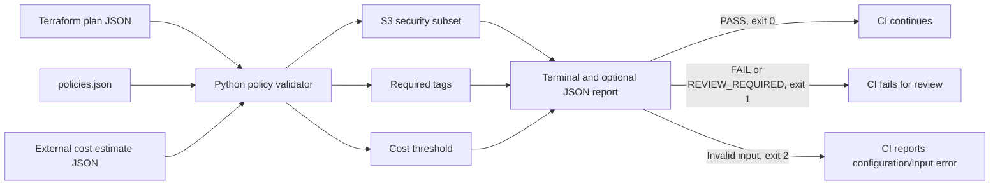

# Terraform Plan Policy Validator

A small, offline Python 3.11+ tool that validates Terraform plan JSON against a JSON policy file. It checks a documented subset of S3 public-access settings, required tags on selected AWS resource types, and an externally supplied monthly cost estimate. Policy failures return exit code `1`, so CI can block promotion before apply.

This is a code-only lab. It does not connect to a cloud account, require credentials, create resources, execute Terraform, or change Terraform state.

## Original problem statement

> Write a Python tool that validates Terraform plans against a policy-as-code ruleset (e.g., no public S3 buckets, required tags, cost thresholds) and fails the pipeline if violated.

## Enterprise business scenario

Shared infrastructure teams need repeatable checks before approving infrastructure changes. A plan may accidentally grant public storage access, omit ownership metadata, or exceed an approved budget. Running these checks in CI creates an early, consistent feedback point before an operator applies the plan. This tool is a preventive check; it does not replace cloud IAM, security monitoring, or a comprehensive policy engine.

## Architecture



The validator reads local JSON files only. Terraform plan JSON can be produced outside this lab using `terraform show -json tfplan`; running Terraform is not part of the project.

## Repository structure

```text
coding-clinic/
├── .github/workflows/ci.yml
├── README.md
└── terraform-plan-policy-validator/
    ├── LICENSE
    ├── .gitignore
    ├── validator.py
    ├── policies.json
    ├── examples/
    └── tests/test_validator.py
```

## Prerequisites and installation

- Python 3.11 or newer.
- No third-party Python packages are required.
- Terraform CLI is optional and is not used by the validator or tests.

Clone or enter this project directory; there is no package installation step. The included plans and estimates are synthetic examples. To validate your own plan later, generate its JSON securely in your own workflow and provide a separately generated cost estimate.

## Policy configuration

Edit `policies.json` without changing Python code:

```json
{
  "required_tags": ["Environment", "Owner", "Project"],
  "enforce_s3_private": true,
  "max_monthly_cost_usd": 500
}
```

The file must contain all three fields. Tag names must be a non-empty list of unique strings; `enforce_s3_private` must be a boolean; and the budget must be a finite, non-negative number. Invalid policy data is an input error and returns exit code `2`.

## Policy behavior

### S3 access checks

When `enforce_s3_private` is true, the tool examines planned create/update actions for `aws_s3_bucket`, `aws_s3_bucket_acl`, `aws_s3_bucket_public_access_block`, and `aws_s3_bucket_policy`.

- Public canned ACLs (`public-read`, `public-read-write`, `authenticated-read`) and ACL grants to the AWS global AllUsers or AuthenticatedUsers groups fail.
- Each explicitly planned public access block must set all four controls to `true`: `block_public_acls`, `ignore_public_acls`, `block_public_policy`, and `restrict_public_buckets`. A planned `false` fails; a missing or unknown setting requires review.
- An unconditional `Allow` bucket-policy statement with a wildcard principal fails. A wildcard principal with a condition requires review because this tool does not evaluate IAM policy conditions.
- Unknown ACL/policy values, or policy documents the tool cannot interpret, require review and fail closed.
- Absence of a public access block from a plan does not prove the bucket is public or private, so absence alone is not reported as a violation. Protections configured outside the plan are not assessed.

These checks intentionally cover a narrow subset of S3 exposure behavior. They do not model every IAM principal, condition operator, access point, organization control, account-level setting, or cross-resource interaction. A `REVIEW_REQUIRED` result is not a claim that the resource is public; it means the tool cannot prove it safe.

### Required tags

The validator checks final planned `tags` and `tags_all` values for create and update operations on this explicit supported set: `aws_instance`, `aws_launch_template`, `aws_security_group`, `aws_vpc`, `aws_subnet`, `aws_ebs_volume`, `aws_kms_key`, `aws_iam_role`, `aws_lambda_function`, `aws_dynamodb_table`, `aws_rds_cluster`, `aws_db_instance`, `aws_s3_bucket`, `aws_sqs_queue`, `aws_sns_topic`, `aws_ecs_cluster`, `aws_ecs_service`, and `aws_eks_cluster`.

Delete-only changes are ignored. Other resource types are not assumed to support tags. A missing required tag fails and identifies the Terraform resource address. An unknown planned required tag requires review and fails closed. `tags_all` is included because provider defaults or inherited tags may appear there; this is still based only on values present in the plan JSON.

### Cost threshold

Terraform plans do not provide reliable AWS prices. Supply a separate cost estimate created by an external estimation process:

```json
{"estimated_monthly_cost_usd": 420.00}
```

The estimate is compared to `max_monthly_cost_usd` using Python `Decimal`. Negative, non-finite, malformed, or missing estimates are input errors. An estimate equal to the limit passes; a greater estimate fails. This tool does not calculate AWS billing costs or call pricing APIs.

## Usage

From this project folder:

```bash
python validator.py \
  --plan examples/compliant-plan.json \
  --policy policies.json \
  --cost examples/compliant-cost.json
```

PowerShell:

```powershell
python .\validator.py `
  --plan .\examples\compliant-plan.json `
  --policy .\policies.json `
  --cost .\examples\compliant-cost.json
```

To see a policy failure:

```bash
python validator.py \
  --plan examples/noncompliant-plan.json \
  --policy policies.json \
  --cost examples/over-budget-cost.json
```

To save a machine-readable summary, add `--output report.json`. The output includes overall status, check statuses, the count of planned create/update resources, and messages with affected resource addresses. It deliberately excludes planned tag values and policy contents. The report file is the only file the validator can write, and only when explicitly requested.

### Example results

The compliant fixture reports:

```text
S3 Security: PASS
Required Tags: PASS
Cost Threshold: PASS
Resources checked: 3
Overall Result: PASS
```

The noncompliant fixtures report `FAIL` for S3 security, required tags, and cost threshold, including resource-specific remediation messages.

### Exit codes

| Code | Meaning |
| --- | --- |
| `0` | All checks passed |
| `1` | A policy was violated or needs review |
| `2` | Input, policy, cost estimate, or optional report path is invalid |

The plan input must be Terraform plan JSON with a top-level `format_version` string and a `resource_changes` array. Terraform state JSON is not accepted as a substitute.

## Testing

Run the offline suite using only the standard library:

```bash
python -m unittest discover -s tests -v
```

Tests use synthetic plans and temporary files. They cover compliant/noncompliant plans, public ACL and policy behavior, access-block settings, tags, deletion and nested-module addresses, unknown values, cost boundaries and errors, malformed JSON, empty changes, and CLI exit codes. Tests do not use cloud credentials or contact external services.

## GitHub Actions CI

The single repository workflow, `.github/workflows/ci.yml`, runs this lab on pull requests and pushes to `main` when project files or the workflow change. It grants only `contents: read`, checks Python syntax and JSON fixtures, runs `unittest`, validates the passing example, and confirms the failing example returns policy exit code `1`. It does not authenticate to a cloud provider, execute Terraform, or modify infrastructure.

## Security considerations

- Run policy validation before an approved deployment or apply stage.
- No cloud credentials or network access are required by this validator.
- CI has least-privilege read-only repository permission.
- Invalid inputs and unresolved enforced-policy values fail closed.
- Terraform plan JSON may contain secrets or sensitive values. Do not commit real plans, upload them to broadly accessible artifacts, or print their contents in logs. This repository uses synthetic fixtures only.
- Reports include addresses and remediation messages, not plan values.
- The tool is a preventive governance check, not a replacement for IAM controls, cloud security monitoring, provider validation, or enterprise policy engines.

## Idempotency and limitations

The validator is read-only and deterministic for identical input files. It never modifies a plan, policy, Terraform state, or cloud resource. It writes a JSON report only when `--output` is explicitly requested. Cost estimates are supplied externally, and the S3 analysis intentionally recognizes only a documented subset of exposure patterns. Unknown cases require human review and cause CI to fail; the tool does not claim complete public-exposure analysis.

## Future improvements

Possible follow-up work includes richer policy rules, more provider-specific taggable resource types, reviewed IAM-condition analysis, and standardized integration with an external cost-estimation job. Those features are not part of this lab.

## Lab scope

This is a code-only project. No AWS resources were deployed, no live cloud accounts were accessed, no cloud credentials were used, and no real Terraform plan or state was modified.
