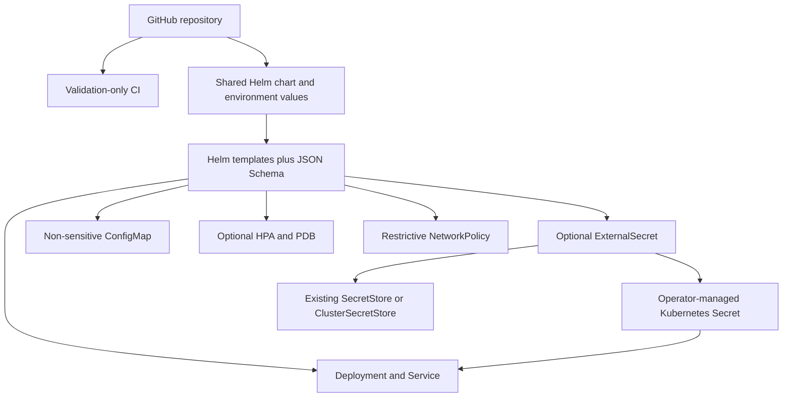

# Reusable Helm Chart for a 12-Factor Kubernetes Application

This code-only lab provides a reusable Helm 3 chart for configuring a containerized application with environment-specific values, health probes, resource controls, autoscaling, disruption budgets, network restrictions, and optional External Secrets Operator integration.

The default image is the public `nginxinc/nginx-unprivileged` image for rendering and learning. Nginx is only a demonstration workload; using it does not prove that an application follows all 12-factor principles. Replace it with an application image that supports the chart's non-root and read-only filesystem settings.

No cluster has been contacted and no Kubernetes or cloud resources have been created.

## Original Code Clinic problem

> Write a Helm chart + values schema that deploys a 12-factor application with HPA, PDB, NetworkPolicy, and External Secrets Operator integration.

## Enterprise business problem

Teams often copy Kubernetes manifests between environments. Duplicated YAML drifts over time, so security, probes, resource budgets, and operational settings become inconsistent. A shared chart with reviewed DEV, STAGE, and PROD values keeps the deployment shape reusable while making environment-specific differences visible.

## Architecture



The chart creates an ExternalSecret only when enabled. It assumes the External Secrets Operator, its CRDs, a compatible store, and the necessary store permissions already exist. The chart does not install or configure those prerequisites.

## Repository structure

```text
helm-12factor-app-chart/
├── charts/twelve-factor-app/
│   ├── Chart.yaml
│   ├── values.yaml
│   ├── values.schema.json
│   └── templates/
│       ├── _helpers.tpl
│       ├── deployment.yaml
│       ├── service.yaml
│       ├── configmap.yaml
│       ├── hpa.yaml
│       ├── pdb.yaml
│       ├── networkpolicy.yaml
│       └── externalsecret.yaml
├── environments/
│   ├── dev-values.yaml
│   ├── stage-values.yaml
│   └── prod-values.yaml
├── scripts/validate.sh
├── README.md
├── LICENSE
└── .gitignore
```

In this monorepo, CI lives in the single root workflow directory at `../.github/workflows/ci.yml`. The Problem 11 job is path-scoped to this project.

## Prerequisites

- Helm 3.16.4 or a compatible Helm 3 release.
- Bash for `scripts/validate.sh`.
- A POSIX-compatible shell environment such as Linux, macOS, WSL, or Git Bash on Windows.

No kubeconfig, cloud CLI, credentials, secret-manager access, or Kubernetes cluster is needed for local linting and rendering.

## How the chart works

The chart is named `twelve-factor-app`, uses Helm chart API v2, and has chart version `0.1.0`. It renders declarative Kubernetes resources from `values.yaml` and a selected environment values file:

- **Deployment:** configures the image, ports, environment, ConfigMap and secret references, resource requests and limits, probes, and restricted security contexts. Rolling updates keep at least one pod available during a normal rollout.
- **Service:** exposes the selected pods internally as ClusterIP by default. No public endpoint is created by default.
- **ConfigMap:** contains only non-sensitive settings. A checksum annotation causes a Deployment rollout when the rendered ConfigMap changes.
- **HPA:** optionally scales the Deployment using CPU utilization. Deployment replicas are omitted when HPA is enabled.
- **PDB:** optionally limits voluntary disruptions using `minAvailable`.
- **NetworkPolicy:** selects this chart's pods, allows HTTP only from configured namespace selectors, and restricts egress to configured DNS and CIDR destinations.
- **ExternalSecret:** optionally asks the existing operator to populate a Kubernetes Secret. The Deployment references the target Secret keys as environment variables.

### 12-factor configuration

The chart supports configuration through environment variables and mounted/runtime configuration rather than embedding environment-specific settings in an image. It does not implement the 12 factors for an application automatically. Application code still needs to handle configuration, logs, processes, backing services, concurrency, disposability, and the other factors appropriately.

The `app.config` map is rendered into a ConfigMap and exposed through `envFrom`. Do not put passwords, tokens, private keys, or API keys there. Use `secretEnv` to reference a pre-existing Secret or enable ExternalSecret integration for operator-managed values.

### HPA

When enabled, the chart creates an `autoscaling/v2` HPA targeting the Deployment's CPU utilization. CPU requests must be set because utilization is calculated relative to requests. The cluster must expose resource metrics, commonly through Metrics Server. HPA cannot make an overloaded or unhealthy application reliable by itself; set requests based on measurement and configure sensible scale bounds.

The template rejects `maxReplicas < minReplicas`. CPU requests are part of the required resource schema.

### PDB

The optional `policy/v1` PodDisruptionBudget uses `minAvailable` and selects the same pods as the Deployment. The chart rejects a `minAvailable` value greater than or equal to the lowest configured replica count because that can block voluntary maintenance from evicting any pod.

A PDB helps coordinate voluntary disruptions such as node drain. It does not guarantee availability during node, zone, application, or dependency failures. DEV uses one replica and disables the PDB so it does not obstruct routine maintenance.

### NetworkPolicy

The default policy restricts ingress to pods in the `ingress-nginx` namespace and allows DNS egress to pods in the `kube-system` namespace selected with `k8s-app: kube-dns`. These selectors are common examples, not universal conventions; verify the labels used by your cluster. Add only the egress CIDRs and ports the application needs.

NetworkPolicy enforcement requires a compatible CNI. A cluster may accept the resource but fail to enforce it. Validate the rendered selectors and test enforcement in a non-production cluster before relying on the policy.

### External Secrets Operator

STAGE and PROD show synthetic ExternalSecret references. They do not contain secret values or real secret-manager paths. The generated Secret is consumed by the Deployment as environment variables.

Before enabling this feature in a real environment, an administrator must install the operator and CRDs, configure a namespaced SecretStore or ClusterSecretStore, and grant least-privilege access to the necessary external secret paths. Store scope and remote provider permissions determine the real secret access boundary. Missing operator, CRD, store, permissions, or remote keys prevents synchronization.

### Values schema

`values.schema.json` is a JSON Schema consumed by Helm during lint and template operations. It checks types and bounds for common settings such as image repository, ports, replicas, HPA ranges, CPU target, PDB values, network selectors, and ExternalSecret data. The helper templates handle cross-field checks that are clearer at render time, including HPA minimum/maximum and PDB availability versus the scale floor.

## DEV, STAGE, and PROD examples

All environments use the same chart. The values files override only environment-specific settings:

| Environment | Replicas / HPA | PDB | Resource requests | ExternalSecret |
| --- | --- | --- | --- | --- |
| DEV | 1 / disabled | disabled | 50m CPU, 64Mi memory | disabled |
| STAGE | 2–4 / CPU target 70% | minAvailable 1 | 200m CPU, 256Mi memory | enabled with synthetic key |
| PROD | 3–6 / CPU target 65% | minAvailable 2 | 500m CPU, 512Mi memory | enabled with synthetic key |

STAGE and PROD include `198.51.100.25/32`, a documentation-only address, as an example allowed egress destination. Replace it with a real, narrowly scoped dependency CIDR only after reviewing the network design.

## Local validation

From this project directory, run:

```bash
helm lint charts/twelve-factor-app
helm template demo-dev charts/twelve-factor-app -n app-dev -f environments/dev-values.yaml
helm template demo-stage charts/twelve-factor-app -n app-stage -f environments/stage-values.yaml
helm template demo-prod charts/twelve-factor-app -n app-prod -f environments/prod-values.yaml
bash scripts/validate.sh
```

The script lints the chart, renders all three environments, checks that optional resources appear only in the intended environments, confirms the HPA-enabled Deployment omits a fixed replica count, and verifies Helm rejects an invalid image repository and invalid HPA bounds. These commands only render YAML locally. They do not install or upgrade a release.

## GitHub Actions CI

The repository's shared workflow in `../.github/workflows/ci.yml` runs on pull requests and pushes to `main` when this project or the workflow changes. Its Problem 11 job checks out the repository, installs a pinned Helm version, runs `helm lint`, renders each environment, and runs the local validation script. Permissions are limited to `contents: read`. CI does not authenticate to Kubernetes or a cloud provider and does not deploy.

## Security considerations

- Keep credentials and secret values out of chart values, ConfigMaps, source control, and rendered artifacts.
- Use External Secrets Operator references or pre-existing Kubernetes Secrets; scope store permissions to the required remote paths.
- Use Kubernetes RBAC with least privilege and protect production values changes with review.
- Use image tags that identify a reviewed release; for production, consider pinning by digest and maintain a controlled update process.
- Run compatible non-root images. The default pod uses UID/GID 101, a read-only root filesystem, dropped Linux capabilities, no privilege escalation, and RuntimeDefault seccomp. Images must support these settings and writable temporary paths.
- Set realistic resource requests and limits and make probes reflect application readiness and liveness.
- Restrict ingress and egress intentionally. Validate namespace labels, DNS labels, and CNI enforcement in the target cluster.
- Helm values and templates do not replace cluster policy, admission controls, image scanning, secret-store IAM, network segmentation, or runtime monitoring.

## Idempotency and operations

Helm templates describe desired Kubernetes objects. Rendering the same chart version with the same values produces equivalent manifests, and Helm upgrades update the managed resources instead of intentionally creating duplicates. HPA adjusts replicas within its configured range, and External Secrets Operator reconciles the target Secret. NetworkPolicy and PDB are declarative resources.

An upgrade can still change availability or access. Image, probe, resource, selector, PDB, secret mapping, and network changes need review. For production, use a protected deployment path, inspect rendered diffs, monitor rollouts, and keep a tested rollback plan. A PDB can also delay maintenance if configured too strictly.

External Secrets Operator updates the Kubernetes Secret, but a process that consumes a Secret through environment variables does not see changed values until its pods restart. Plan rotation so the workload restarts safely, or use a reload-aware application and a mounted Secret volume pattern.

## Limitations and future improvements

This lab does not validate Kubernetes admission behavior against a live cluster, check that NetworkPolicy is enforced by a CNI, verify External Secrets Operator CRDs or remote provider permissions, scan images, or deploy the chart. The Nginx workload is a rendering example, not a complete 12-factor service. Network labels and DNS selectors may differ between clusters.

Future work could add offline Kubernetes schema validation, chart packaging and provenance, image digest verification, and policy tests for organization-specific network and security requirements.

This project is code-only. No Kubernetes resources were deployed, no cloud resources were created, no secret manager was accessed, and nothing was pushed to GitHub.

