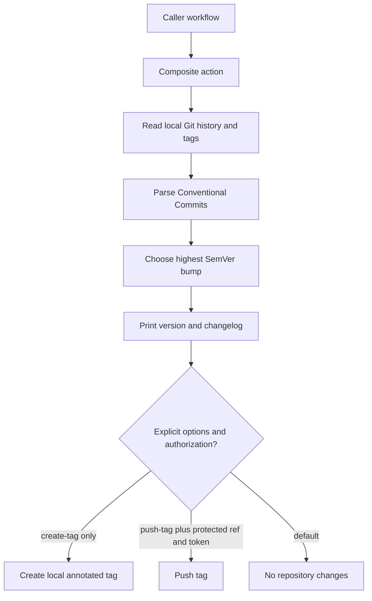

# Reusable GitHub Actions Semantic Versioning Automation

This Code Clinic lab contains a reusable composite action that reads Conventional Commits, calculates the next semantic version, produces a changelog section, and can create an annotated local Git tag. It is code-only: it provisions no infrastructure and does not create GitHub releases.

## Assignment problem statement

Enterprise teams often maintain versions, changelogs, and tags by hand across many repositories. That creates inconsistent versions, missed change notes, incorrect release tags, and avoidable operator errors. Build a reusable GitHub Actions composite action that applies Conventional Commit rules to prepare a consistent release. The default must be a safe dry-run; publishing must be explicit and guarded.

## Architecture



The action code is resolved from its own `github.action_path`; Git history and tags are read from the caller's checked-out working directory.

## Repository structure

| Path | Purpose |
| --- | --- |
| `action.yml` | Composite-action inputs, outputs, and invocation |
| `scripts/release.py` | Standard-library version calculation, changelog, and safe Git operations |
| `tests/test_release.py` | Offline unit and temporary Git repository tests |
| `examples/workflow.yml` | Consumer workflow, pinned checkout action, publishing disabled |
| `.github/workflows/ci.yml` | Read-only validation workflow |
| `LICENSE` | MIT license |

## Prerequisites

- Git 2.x and Python 3.10 or newer for local use.
- GitHub Actions for hosted execution.
- The caller workflow must check out full history and tags (`fetch-depth: 0`), otherwise the baseline and commit range may be incomplete.

## Version rules

Versions use `MAJOR.MINOR.PATCH` and tags use `v` (for example, `v1.2.3`). `fix:` requests PATCH, `feat:` requests MINOR, and either a `!` marker or a `BREAKING CHANGE:` footer requests MAJOR. `docs:`, `chore:`, and other non-feature/fix commits do not trigger a release unless marked breaking. The highest bump among commits since the latest valid tag wins. When no valid version tag exists, the baseline is `0.0.0`, so the first `feat:` release is `0.1.0` and the first breaking release is `1.0.0`.

## Local use

Run from the caller repository root with Git history available:

```bash
python3 /path/to/github-actions-semantic-release/scripts/release.py --dry-run true --create-tag false --push-tag false
```

The script prints current/next version, release type, tag name, and generated changelog. It does not modify repository state in dry-run mode. It reports that no release is required when the commit range contains no qualifying changes.

To create a local annotated tag deliberately:

```bash
python3 /path/to/github-actions-semantic-release/scripts/release.py --dry-run false --create-tag true --push-tag false
```

This only creates a local tag and refuses to overwrite a tag with the same name. Review the planned version first. The script prints a generated changelog section; it does not write or commit `CHANGELOG.md`. Save and commit changelog content separately if it should be part of project history.

## GitHub Actions use

See [`examples/workflow.yml`](examples/workflow.yml). Replace `example-org` with the action's published owner and repository. The example checks out full history, pins third-party actions to commit SHAs, grants `contents: read`, and leaves all publishing options disabled.

The action exposes `current-version`, `next-version`, `release-type`, `tag-name`, and `changelog`. Callers must never put these outputs into shell source; pass dynamic values through environment variables when using shell steps.

### Optional authorized tag publishing

Publishing is not configured in the sample CI. An organization choosing to enable it must use a dedicated protected GitHub Environment and branch protection/rulesets, require approval from authorized operators, grant only the publishing job `contents: write`, and ensure checkout persisted credentials for that token. Set the repository/organization variable `RELEASE_PUBLISH_AUTHORIZED=true` only for the approved workflow, set `dry-run: 'false'`, `create-tag: 'true'`, and `push-tag: 'true'`. The action also requires GitHub to report `github.ref_protected` as true and requires a `GITHUB_TOKEN`. A branch name such as `main` alone is not evidence of protection. GitHub does not expose whether a particular workflow approval policy was satisfied to a composite action; protected Environment approval and tightly scoped workflow permissions remain external controls. Never enable publishing on untrusted pull requests and do not use `pull_request_target`.

## Changelog behavior

The generated section includes feature and bug-fix commits grouped under headings. Existing changelog history is preserved, and an already-present version heading is not duplicated. For this minimal action, changelog generation is returned as output and printed locally; no file is automatically committed or pushed.

## Security and idempotency

- Defaults are `dry-run: true`, `create-tag: false`, and `push-tag: false`.
- CI uses `contents: read`; it does not have a publishing job.
- Tag names are constructed from validated numeric semantic versions; tags are annotated and existing tags are never replaced or force-pushed.
- Git commands use argument arrays through Python `subprocess`, never `shell=True`.
- Tokens are not hardcoded or printed. The publishing token must be supplied through GitHub's protected workflow context with the smallest required permission.
- Each run uses a tag-based history boundary. Re-running without new qualifying commits produces no new release; existing changelog headings and tags are preserved.
- SSH hardening is not part of this code-only release automation; release publishing safeguards are the relevant access-control boundary here.

## Tests and CI

Run the offline test suite with:

```bash
python -m unittest discover -s tests -v
```

Tests cover patch/minor/major selection, breaking footers, precedence, non-release commits, the first-release baseline, numeric tag ordering, changelog history and duplicate sections, dry-run state, duplicate tags, and invalid versions. Git-related cases use temporary local repositories; they do not access GitHub or push.

The repository CI runs on pull requests and pushes to `main`. It performs Python syntax checks, unit tests, action YAML parsing, and a dry-run invocation, with `contents: read` only. The workflow's YAML parser is provided by the hosted runner's Python environment; if it is unavailable, replace that step with a pinned YAML-validation action or add PyYAML as an explicit CI dependency.

## Limitations and future work

This lab is code-only and does not involve cloud infrastructure. No remote Git tags were pushed and no live GitHub release was published. Local tag creation is implemented but disabled by default. GitHub Releases integration and richer release notes are possible future additions and are intentionally not implemented here.
