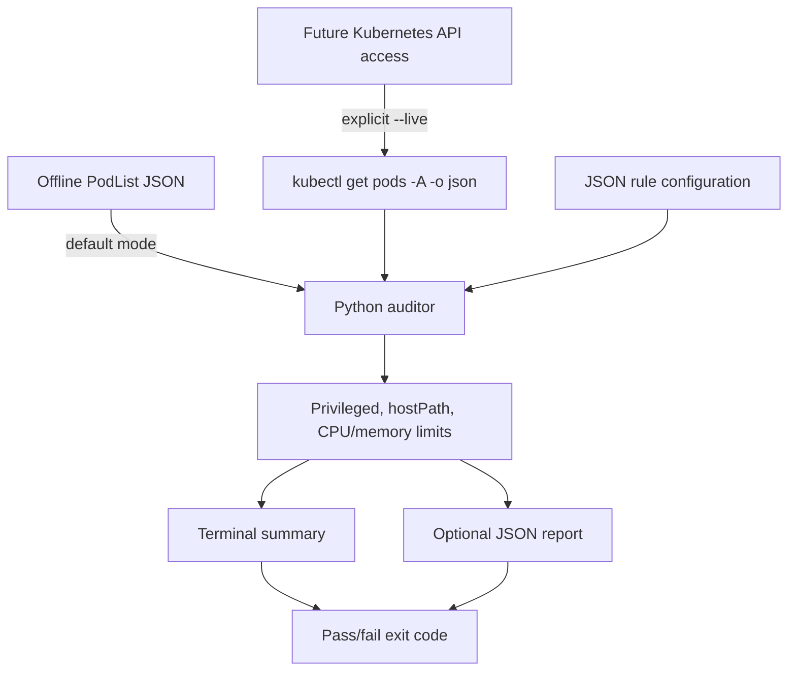

# Kubernetes Pod Security and Compliance Auditor

A read-only Python tool that audits Kubernetes PodList JSON for privileged containers, hostPath volumes, and missing CPU or memory limits. It supports offline fixtures by default and optional live read-only discovery through kubectl only when the operator explicitly passes `--live`.

This Code Clinic lab uses synthetic pod data. No cluster was accessed and no workload was modified.

## Original Code Clinic problem

> Create a Bash/Python script that audits all running pods in a cluster for privileged containers, hostPath mounts, and missing resource limits, outputting a compliance report.

## Enterprise business problem

Clusters can accumulate workloads with broad host access, elevated container privileges, or missing resource limits. These settings can increase node-level risk, resource contention, and operational unpredictability. Platform teams need a repeatable report that identifies the relevant Pod specifications without changing them.

The tool is intentionally read-only. It does not remediate findings, create Kubernetes resources, or inspect workload templates.

## Architecture



Live mode only invokes `kubectl get pods --all-namespaces -o json`. No shell is used, and the script has no write operations.

## Repository structure

```text
coding-clinic/
├── README.md
├── .github/workflows/ci.yml
└── kubernetes-pod-security-auditor/
    ├── auditor.py
    ├── config.json
    ├── examples/
    │   ├── compliant-pods.json
    │   └── noncompliant-pods.json
    ├── tests/test_auditor.py
    ├── LICENSE
    └── .gitignore
```

The monorepo keeps CI in the single root workflow folder at [`.github/workflows/ci.yml`](.github/workflows/ci.yml).

## Prerequisites and installation

- Python 3.11 or newer.
- `kubectl` is needed only for future live mode.
- Offline JSON mode and tests use only Python's standard library. No AWS credentials, kubeconfig, Kubernetes Python SDK, or cluster access is needed.

From the repository root, change into the project folder, then run:

```bash
cd kubernetes-pod-security-auditor
python auditor.py --input examples/compliant-pods.json --config config.json
python -m unittest discover -s tests -v
```

The same standard-library-only program works without installing Python packages.

## Configuration

The checked-in `config.json` enables all three rules and fails the command when violations are present:

```json
{
  "check_privileged": true,
  "check_hostpath": true,
  "check_resource_limits": true,
  "fail_on_violations": true
}
```

All four keys are required and must be JSON booleans. Unknown keys and invalid types return exit code 2. Set a rule to `false` to disable only that check. When `fail_on_violations` is false, the report still says `FAIL` if findings exist, while the process returns 0 so the report can be collected without blocking a pipeline.

## What the auditor checks

Only pods whose `status.phase` is exactly `Running` are audited. Other phases, including Pending, Succeeded, Failed, and Unknown, are counted as skipped. Pod phase does not guarantee every container is currently running; this lab uses phase as the requested selection rule.

For each running Pod, the auditor:

- Checks regular and init containers for `securityContext.privileged: true`. A missing or false value is not treated as privileged.
- Checks pod-level volumes for any non-null `hostPath`. ConfigMap, Secret, and emptyDir volumes are not flagged. A printable absolute host path of up to 256 characters is included in the report; unusual or unsafe paths are omitted.
- Checks regular and init containers for both `resources.limits.cpu` and `resources.limits.memory`. Requests do not count as limits.
- Checks ephemeral containers for privileged mode, but does not require resource limits for them.

A Pod with several findings is counted once as noncompliant, with each distinct rule finding in the violation list. The report includes namespace, pod, rule, description, and container or volume details where relevant. Pod environment variables and their values are never copied into reports.

Kubernetes LimitRange admission defaults can affect the effective Pod spec returned by the API. This simple tool checks the current Pod specification, not whether a workload template explicitly declared a limit or whether a default is appropriate.

## Offline usage and reports

Audit a compliant fixture:

```bash
cd kubernetes-pod-security-auditor
python auditor.py --input examples/compliant-pods.json --config config.json
```

Audit the noncompliant fixture and write JSON:

```bash
python auditor.py \
  --input examples/noncompliant-pods.json \
  --config config.json \
  --output report.json
```

The JSON report contains summary counts, overall result, and structured violations. Only the explicitly requested report file is created. The terminal report is also printed.

Exit codes:

| Code | Meaning |
| ---: | --- |
| 0 | Audit completed with no blocking findings, or findings are non-blocking by configuration |
| 1 | Audit completed and blocking violations were found |
| 2 | Invalid JSON/configuration/input or audit execution failed |

The noncompliant example intentionally returns 1 with the default configuration.

## Future live cluster usage

Live discovery requires explicit opt-in:

```bash
python auditor.py --live --config config.json
```

This command is documented for future use only and was **not run** during this lab. Before use, arrange a kubeconfig and identity with read-only permission to list Pods across the intended namespaces. A cluster-wide `kubectl get pods --all-namespaces` generally requires appropriately scoped list access across namespaces. Do not grant write permissions for this auditor. Protect kubeconfig files like credentials and avoid placing them in the repository.

The tool uses a fixed argument list with `subprocess.run(..., shell=False)`, a timeout, and no command output in errors. It does not fall back to live mode if an offline file is missing.

## GitHub Actions CI

The single root workflow at `.github/workflows/ci.yml` runs on pull requests and pushes to `main`. It checks Python syntax, runs the standard-library unittest suite, audits the compliant fixture, verifies that the noncompliant fixture exits with code 1, and parses the JSON configuration and fixtures. Permissions are limited to `contents: read`.

CI does not connect to Kubernetes or a cloud provider, modify resources, or deploy applications.

## Security considerations

- Use offline fixtures for development and review.
- Live access is explicit and read-only; use least-privilege Pod list access only.
- The auditor does not need cloud credentials or Kubernetes write permissions.
- Reports contain workload identifiers and findings, not environment variables or secret values. Treat reports as operational metadata and store them according to organizational policy.
- hostPath paths can reveal host filesystem layout. The report includes only printable absolute paths under the configured length limit.
- Privileged containers and hostPath mounts may be necessary for trusted system workloads. Review findings in context, but do not automatically whitelist every system namespace.
- The script does not remediate violations or create an allowlist.
- Protect kubeconfig files and never commit them.

## Idempotency and limitations

The auditor is read-only. Repeated runs with identical input and configuration produce the same findings and counts. It does not modify Pods, Deployments, Namespaces, RBAC, Secrets, or cluster configuration; it creates a report file only when `--output` is specified.

The tool is not a complete Kubernetes security or compliance framework. It checks current Pod specifications rather than Deployment, StatefulSet, DaemonSet, Job, or CronJob templates. It does not inspect image provenance, capabilities, seccomp profiles, service accounts, network policy, admission policy, or runtime behavior. A Running Pod can still contain waiting or terminated containers.

Future improvements could add policy severity, workload-template auditing, structured formats for other reporting systems, and narrowly scoped organization-specific rules. Those are outside this simple lab.

This is a code-only project. No Kubernetes cluster was accessed, no workload or infrastructure was modified, and live mode was not run.

