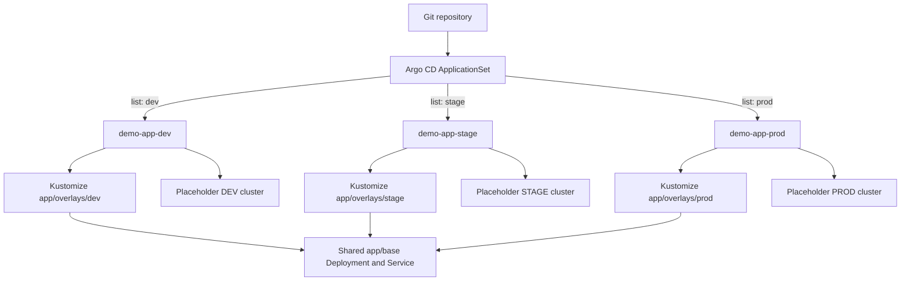

# Argo CD ApplicationSet and Kustomize Multi-Cluster GitOps

This code-only lab defines one Nginx application and generates DEV, STAGE, and PROD Argo CD Applications from a simple ApplicationSet list generator. Kustomize keeps the shared Deployment and Service in one base and applies small environment overlays. No cluster connection, cloud credentials, or deployment is used by the lab.

## Original assignment

> Build an Argo CD ApplicationSet + Kustomize/Helm pattern that deploys the same application across multiple clusters/environments with environment-specific overlays.

This implementation uses Kustomize to keep the project focused and avoid duplicated manifests.

## Business scenario

Platform teams often need to run the same service in several clusters while varying replica counts, namespaces, resource budgets, and environment settings. Copying manifests for each environment encourages drift. A shared base with small overlays keeps common behavior reviewable and makes deliberate differences explicit.

## Architecture



This diagram describes the intended flow. The repository does not connect to or configure any cluster.

## Repository structure

```text
argocd-multicluster-gitops/
├── applicationset.yaml
├── app/
│   ├── base/
│   │   ├── deployment.yaml
│   │   ├── service.yaml
│   │   └── kustomization.yaml
│   └── overlays/
│       ├── dev/
│       ├── stage/
│       └── prod/
├── scripts/validate.sh
├── README.md
├── LICENSE
└── .gitignore
```

The monorepo uses one repository-level workflow at [`../.github/workflows/ci.yml`](../.github/workflows/ci.yml), with a path-scoped job for this lab. Keeping workflows at the repository root avoids duplicate workflow folders.

## Technology and prerequisites

- Argo CD ApplicationSet and Kubernetes manifests.
- Kustomize through `kubectl kustomize`; no Kubernetes context is needed.
- Bash, Python 3.11+, and PyYAML for local validation.
- `yamllint` for YAML linting in CI.
- No Helm, Terraform, Docker build, cloud CLI, or credentials.

Install the lightweight YAML parser for local validation if needed:

```bash
python3 -m pip install PyYAML==6.0.3
```

Install `kubectl` for your operating system. CI installs `kubectl` and `yamllint`. The validation script only uses `kubectl kustomize`; it never reads a kubeconfig or contacts a cluster.

## ApplicationSet

`applicationset.yaml` uses one list generator with three entries. Each maps an environment to a placeholder API URL, namespace, and overlay path. A shared template generates `demo-app-dev`, `demo-app-stage`, and `demo-app-prod` in the `default` Argo CD project.

The source URL uses `example-org`; replace it with the published repository URL before configuring Argo CD. `targetRevision` is `main`. The placeholder cluster URLs end in `.example.invalid` and must be replaced by cluster destinations already registered with Argo CD. Cluster registration is an external prerequisite and is not performed here.

Automated sync and self-healing are enabled. Automatic pruning is disabled so deleting a manifest from Git does not automatically remove its live resource. Review deletion behavior before enabling pruning. `CreateNamespace=true` lets Argo CD create the destination namespace; each overlay also includes its Namespace manifest so the environment label is declarative.

## Kustomize base and overlays

The base contains a Deployment and ClusterIP Service for `demo-app`. The Deployment uses the version-pinned `nginxinc/nginx-unprivileged:1.27.5-alpine` image, listens on port 8080, and defines readiness and liveness probes, resource defaults, a non-root UID, a runtime-default seccomp profile, no privilege escalation, and dropped Linux capabilities.

Each overlay references the base and patches only the environment-specific values:

| Environment | Namespace | Replicas | CPU request / limit | Memory request / limit |
| --- | --- | ---: | --- | --- |
| DEV | `app-dev` | 1 | `50m` / `250m` | `64Mi` / `128Mi` |
| STAGE | `app-stage` | 2 | `100m` / `500m` | `128Mi` / `256Mi` |
| PROD | `app-prod` | 3 | `250m` / `1` | `256Mi` / `512Mi` |

Each overlay labels resources and Pods with the environment and sets `APP_ENV`. Production resource settings do not replace normal protected-branch and pull-request review; approval automation is not configured.

## Local validation

Run these commands from this project directory. They render manifests locally and do not communicate with a cluster:

```bash
kubectl kustomize app/overlays/dev
kubectl kustomize app/overlays/stage
kubectl kustomize app/overlays/prod
bash scripts/validate.sh
```

The validation script checks required files, parses YAML locally, verifies the ApplicationSet generator and overlay paths, renders all overlays, and checks namespaces, replicas, environment labels, and resource requests/limits. It rejects Kubernetes Secret manifests and credential-bearing URLs. Invalid YAML or missing configuration returns a nonzero exit code.

## GitHub Actions CI

The single workflow at the repository root runs on pull requests and pushes to `main` when this project or the workflow changes. It installs pinned Python and kubectl versions, runs yamllint, and executes the offline validation script. Repository permissions are limited to `contents: read`. CI does not log in to Argo CD or Kubernetes, access cloud accounts, or apply manifests.

## How live deployment would work

After publishing the repository, update the placeholder source URL. An Argo CD administrator would install the ApplicationSet in a configured Argo CD control plane. The destination clusters must first be registered, and the Argo CD AppProject must permit the intended destinations, namespaces, and resource kinds. Argo CD would generate one Application per list entry, render the selected Kustomize overlay, and reconcile desired state to its destination cluster.

These are external operational prerequisites only. This lab does not perform them. Do not run `kubectl apply` or `argocd app sync` as part of local validation.

## Security

- Do not commit passwords, tokens, kubeconfigs, cloud credentials, or Kubernetes Secret objects.
- The ApplicationSet contains placeholder cluster URLs and a placeholder source repository.
- Use production AppProjects that restrict source repositories, destinations, namespaces, and resource kinds. The built-in `default` project is used only to keep the example small.
- Use least-privilege Argo CD access and register clusters through an approved administrative process.
- Protect the production branch and require pull-request reviews for production overlay changes.
- The container runs as non-root with restricted privileges. For higher assurance, pin the image by a verified digest during release review.
- Automated sync and self-healing can reconcile manual changes. Enabling prune can delete resources removed from Git, so review that behavior before turning it on.
- External Secrets Operator or Sealed Secrets could be evaluated later if the application needs secrets; neither is configured here.

## Idempotency and GitOps behavior

Kubernetes manifests describe desired state. Kustomize composes that state from the shared base and one overlay. Argo CD compares rendered Git state with cluster state and, with automated sync and self-healing enabled, can reconcile drift. Stable API kind, namespace, and object names let Kubernetes update the same Deployment and Service when unchanged manifests are reconciled rather than creating duplicates.

Reconciliation is not risk-free: image, replica, resource, or deletion changes can affect availability. Review production changes and understand sync options before enabling them.

## Limitations and future improvements

This lab does not validate the ApplicationSet against a live Argo CD CRD schema, register clusters, test image availability, estimate capacity, or deploy workloads. Placeholder URLs and repository ownership must be replaced before use. AppProject restrictions, admission policies, secret delivery, and cloud security are outside its scope.

Future work could add Argo CD schema validation, image digest pinning, admission policy examples, and a separately reviewed secrets integration.

No cluster was contacted, no application was deployed, and no cloud resource was created for this lab.
