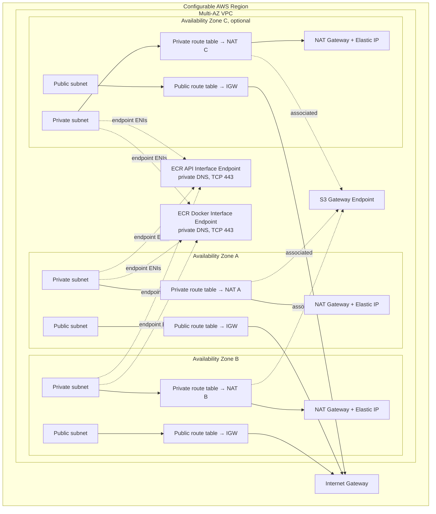

# Enterprise Multi-AZ AWS VPC Terraform Module

Reusable Terraform code for a multi-AZ AWS network foundation. This repository is a **code-only lab**: it defines real AWS resources but does not deploy them. No AWS credentials are needed for mocked Terraform tests or static validation, and no apply/destroy workflow is included.

## Problem statement

Build a reusable Terraform module that provisions a configurable VPC across multiple Availability Zones with public and private subnets, an Internet Gateway, one NAT Gateway and Elastic IP per AZ, and S3/ECR VPC endpoints. The module must support `dev`, `stage`, and `prod` through shared infrastructure logic; discover or explicitly select AZs; allocate deterministic non-overlapping subnet CIDRs; expose useful outputs; and include offline tests, CI validation, and enterprise documentation.

## Architecture



The optional third AZ represents the default module behavior. Environment examples can select a different count or supply AZ names. The module creates one public and private subnet, one public and private route table, and one NAT Gateway per selected AZ.

## Repository structure

| Path | Purpose |
|---|---|
| `modules/vpc/` | Reusable network resources, inputs, outputs, and mocked native tests |
| `environments/dev/` | Dev root configuration with example region/CIDR and two AZs |
| `environments/stage/` | Stage root configuration with three AZs in a separate region/CIDR |
| `environments/prod/` | Prod root configuration with three AZs in a separate region/CIDR |
| `.github/workflows/terraform-ci.yml` | Non-deploying format, validation, lint, scan, and test workflow |
| `.tflint.hcl` | Terraform lint rules |
| `.gitignore` | Ignores Terraform state, downloaded providers, plans, and real tfvars |

The module test root and each environment root have a generated `.terraform.lock.hcl` that records the AWS provider selection and verified checksums. Keep these lock files committed and review provider upgrades deliberately; each Terraform root uses the lock file in its own directory.

## Prerequisites

### Code validation

- Terraform CLI `>= 1.7.0, < 2.0.0` (provider mocking used by tests requires Terraform 1.7 or later).
- AWS provider `~> 5.0` (resolved by `terraform init`).
- Optional: TFLint and Checkov for local static checks; Git.
- No AWS credentials are needed for tests because the AWS provider is mocked.

### Future deployment only

Deployment would additionally need an AWS account, authorized credentials, reviewed remote state and locking, quota/capacity checks, and an approved change process. Those are outside this lab. The example roots intentionally do not configure a backend; `-backend=false` is used in validation.

## Usage

Each environment is a thin root module calling the same `modules/vpc` implementation. Configure its provider region and variables, then inspect a plan in a separately approved future deployment workflow. This lab does not include deployment instructions or automation.

Example module call:

```hcl
provider "aws" {
  region = "us-east-1"
}

module "vpc" {
  source                  = "../../modules/vpc"
  name_prefix             = "clinic-dev"
  environment             = "dev"
  vpc_cidr                = "10.10.0.0/16"
  availability_zone_count = 2
  subnet_newbits          = 4
  endpoint_trusted_cidrs  = null # defaults to the VPC CIDR
  tags                    = { Owner = "platform-team" }
}
```

Environment examples:

| Environment | Example region | VPC CIDR | AZs | Naming prefix |
|---|---|---|---:|---|
| dev | `us-east-1` | `10.10.0.0/16` | 2 | `clinic-dev` |
| stage | `us-west-2` | `10.20.0.0/16` | 3 | `clinic-stage` |
| prod | `us-east-2` | `10.30.0.0/16` | 3 | `clinic-prod` |

Copy the appropriate `terraform.tfvars.example` to `terraform.tfvars` and customize it for a future deployment. Real `*.tfvars` files are ignored by Git. The AWS region is set in each root's provider, not as a module variable; this is the standard Terraform provider model and allows each environment to select its own region.

## Module inputs

| Input | Type | Default | Description |
|---|---|---|---|
| `name_prefix` | `string` | required | Resource naming prefix, 1–40 alphanumeric/hyphen characters, starting alphanumeric. |
| `environment` | `string` | required | Environment tag: `dev`, `stage`, or `prod`. |
| `vpc_cidr` | `string` | `10.0.0.0/16` | Valid IPv4 VPC network from `/16` through `/24`. |
| `availability_zone_names` | `list(string)` or null | `null` | Optional list of at least two unique AZ names; each must be available in the provider region. |
| `availability_zone_count` | `number` | `3` | Integer 2–8, used only when explicit AZ names are null. |
| `subnet_newbits` | `number` | `4` | Integer additional prefix bits; allocation must fit two subnets per AZ and retain at least 32 addresses per subnet. |
| `endpoint_trusted_cidrs` | `list(string)` or null | `null` | IPv4 CIDRs allowed HTTPS to ECR endpoint ENIs; null defaults to the VPC CIDR. |
| `tags` | `map(string)` | `{}` | Additional tags; `Name`, `Environment`, and `ManagedBy` are owned by this module. |

Subnet CIDRs are derived deterministically: for selected AZ index `i`, public uses subnet number `2*i` and private uses `2*i+1`. This makes the CIDRs disjoint within the VPC and stable when AZ ordering and inputs remain stable. Changing AZ ordering or `subnet_newbits` can change addresses and cause subnet replacement; review plans and migration impacts before making such a change.

## Outputs

| Output | Description |
|---|---|
| `vpc_id`, `vpc_cidr` | VPC identifier and configured IPv4 range |
| `availability_zones` | Selected AZ names |
| `public_subnet_ids`, `private_subnet_ids` | Subnet ID maps keyed by AZ |
| `internet_gateway_id` | Attached Internet Gateway ID |
| `nat_gateway_ids` | NAT Gateway ID map keyed by AZ |
| `public_route_table_ids`, `private_route_table_ids` | Route table ID maps keyed by AZ |
| `s3_endpoint_id` | S3 gateway endpoint ID |
| `ecr_api_endpoint_id`, `ecr_dkr_endpoint_id` | ECR interface endpoint IDs |
| `endpoint_security_group_id` | ECR endpoint security group ID |

## Validation and tests

Run formatting across the repository from the repository root:

```bash
terraform fmt -check -recursive
```

Initialize and validate the reusable module from `modules/vpc`:

```bash
terraform init -backend=false
terraform validate
terraform test
```

Initialize and validate each example root from its own directory, or use Terraform's `-chdir` option:

```bash
terraform -chdir=environments/dev init -backend=false
terraform -chdir=environments/dev validate
```

Repeat for `stage` and `prod`. `terraform test` uses a mocked AWS provider and plan-only test runs; it does not call AWS or create resources. Tests cover AZ selection, subnet cardinality and public IP behavior, same-AZ private NAT routing, endpoint types/private DNS, and rejected environment input. CI adds TFLint and a Checkov static scan. A static scanner may report contextual findings that require review; no scanner result substitutes for architecture or plan review.

## Security considerations

- Private subnets have no direct IGW route. Their default route targets the NAT Gateway in the same AZ.
- Public subnet IP assignment is enabled; private subnet IP assignment is disabled.
- ECR interface endpoint ingress is TCP/443 and defaults to the VPC CIDR. For tighter segmentation, pass workload CIDRs that genuinely need ECR access. The endpoint security group egress is limited to the VPC range.
- The module does not create workload security groups, NACLs, IAM roles, or application policies. Those must independently restrict workloads and image access.
- S3 gateway endpoint policies are not customized, so the AWS default endpoint policy applies. Add an explicit least-privilege policy when workload access patterns are known.
- Private ECR pulls need `ecr.api` and `ecr.dkr` endpoints plus S3 access for image layers. Authentication, DNS, IAM permissions, and endpoint policies must also be correct. For isolated environments, ensure the AWS-provided ECR layer buckets are reachable through the S3 gateway endpoint; additional services such as CloudWatch Logs or Secrets Manager may need their own endpoints depending on workload behavior.
- No credentials or secrets are stored in the repository. Provider credentials should use standard AWS credential chains or short-lived roles only in a separately approved deployment context.
- One NAT per AZ reduces cross-AZ dependency and traffic charges but does not make a single AZ's resources or the overall application highly available by itself.

## Idempotency and state

Terraform compares declarative configuration with state and observed provider data, then proposes actions to reconcile differences. Repeated plans against unchanged configuration and infrastructure should converge to no changes, but that is not claimed as verified against live AWS for this lab. State is Terraform's mapping between configuration addresses and real objects; production usage should use a secured remote backend with state encryption, access controls, versioning, and locking. Never share a state file casually or commit it. Drift should be investigated with a reviewed plan and refreshed state; do not blindly apply changes. Renames, CIDR changes, AZ changes, and provider upgrades can replace resources or affect workloads, so assess plan output and migration steps before any future change.

## Design decisions

- **Multiple AZs:** subnet and NAT distribution reduces dependency on a single AZ; at least two are required.
- **One NAT Gateway per AZ:** private routes stay in-AZ, reducing cross-AZ data transfer and avoiding a shared NAT as a network bottleneck. This is more expensive than a single NAT and still requires application-level resilience.
- **Public/private separation:** internet-routable ingress/egress lives in public subnets, while private subnets have outbound-only NAT routing and no IGW route.
- **S3 gateway endpoint:** avoids hourly interface endpoint costs for S3 and is attached to private route tables.
- **ECR interface endpoints:** private DNS exposes ECR APIs and Docker Registry privately; both endpoint types share a constrained security group.
- **Shared module and thin environment roots:** changes to network logic are centralized while region, CIDR, tags, and AZ count vary by environment.
- **Provider region selection:** region belongs to the provider configuration; regional service names are assembled using `aws_region` data from that provider.

## Cost considerations

If deployed, NAT Gateways incur hourly and data processing charges; each also consumes an Elastic IP. ECR interface endpoints incur hourly per-AZ and data processing charges. S3 gateway endpoints have no hourly charge, though normal data transfer and service costs apply. The architecture deliberately prioritizes AZ isolation over minimum cost. This lab performs no deployment and creates no billable AWS resources.

## Limitations

- IPv4 only; no IPv6 CIDR, egress-only IGW, or IPv6 routes.
- No DNS resolver rules, Route 53 private hosted zones, flow logs, NACL customization, or centralized egress inspection.
- No endpoint policy customization or endpoint-specific AWS PrivateLink policy controls.
- No workload compute, security groups, IAM, databases, or application-level health checks.
- No backend/state bucket, remote locking, secrets integration, or deployment workflow.
- No live AWS integration tests; real quotas, service availability, and organization policies must be checked before a future rollout.
- VPC CIDR validation is for IPv4 network syntax and supported prefix range; enterprise IPAM overlap with other networks must be checked separately.

## Future enhancements

Consider adding optional VPC Flow Logs, configurable S3 endpoint policy, IPAM integration, IPv6, centralized egress controls, and organization-specific policy checks when actual workload requirements are known. Add remote state and deployment automation only as a separately reviewed project with explicit credentials and change controls.

