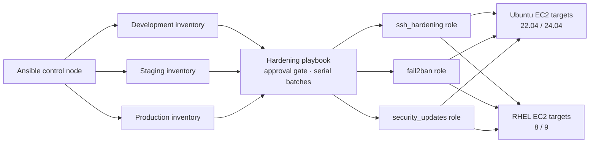

# Enterprise Linux Security Hardening with Ansible

## Project Overview

Reusable Ansible roles for a controlled subset of Linux security hardening on Ubuntu 22.04/24.04 and Red Hat Enterprise Linux 8/9. The roles cover SSH access policy, Fail2ban SSH brute-force protection, and scheduled security updates.

**Code-only lab:** this project was not run against EC2 or any other server. Inventory addresses are reserved documentation ranges. The main playbook defaults to `hardening_approved: false` and checks that value on the Ansible control node before it attempts a connection to a managed host.

## Problem statement

Create an Ansible playbook and reusable roles that harden Ubuntu and RHEL EC2 fleets using a CIS-aligned subset: disable direct root SSH login, configure Fail2ban, set up unattended security updates, and enforce strong SSH settings. The automation must be cross-distribution, parameterized for development/staging/production, idempotent, validated, and documented without deploying infrastructure or contacting live hosts. The original Code Clinic assignment also calls for a standalone enterprise-ready project with clear problem, architecture, prerequisites and usage documentation; organized code and tests; sample configuration; security and idempotency notes; and CI checks for linting and basic validation.

## Business use case

An organization operating hundreds of Ubuntu and RHEL instances across dev, stage, and production needs consistent host-level guardrails while preserving application-specific access patterns. Ansible inventories and group variables let platform teams apply a reviewed baseline in controlled batches, while role defaults establish a reusable minimum. Environment-specific overrides and change approval help reduce manual drift without embedding cloud credentials or requiring AWS discovery.

This project is a starting baseline, not an enterprise policy engine or a complete compliance program. Production rollout still requires representative-image testing, change approval, an access/recovery plan, and integration with the organization's patch orchestration and audit systems.

## Intended architecture

The diagram shows a future approved Ansible control node and example targets. It is not a deployed environment.



## Repository structure

| Path | Purpose |
|---|---|
| `playbooks/harden-linux.yml` | Approval-gated orchestrator and supported-OS checks |
| `roles/ssh_hardening/` | SSH preflight, managed configuration, syntax/effective-config validation, reload handler |
| `roles/fail2ban/` | Ubuntu/RHEL package handling and managed SSH jail |
| `roles/security_updates/` | Ubuntu unattended-upgrades and RHEL dnf-automatic configuration |
| `inventories/{dev,stage,prod}/` | Static demonstration inventories using reserved TEST-NET addresses |
| `group_vars/` | Shared inputs and OS-specific service/package settings loaded by the playbook |
| `examples/` | Copyable inventory and variable examples without credentials |
| `tests/` | Offline YAML, template, defaults, and structure checks |
| `../.github/workflows/ansible-ci.yml` | Repository-level YAML lint, Ansible lint, syntax check, and pytest workflow |

## Supported Operating Systems and Implementation Differences

The playbook rejects anything other than Ubuntu 22.04/24.04 and RHEL 8/9 using gathered Ansible facts, and requires systemd.

| Area | Ubuntu | RHEL |
|---|---|---|
| SSH service | `ssh` | `sshd` |
| SSH drop-in | `/etc/ssh/sshd_config.d/` is included by default | The role ensures the include directive and directory are present before using the drop-in |
| Fail2ban package | Ubuntu archive package `fail2ban` plus `python3-systemd` | Requires the organization to prepare an approved repository; no EPEL is enabled by this role |
| Automatic security updates | `unattended-upgrades` and APT periodic settings | `dnf-automatic`, security-only mode, and one managed systemd install timer |
| Cryptographic policy | OpenSSH package defaults | RHEL system-wide crypto policy is left in control |

Ubuntu's OpenSSH server documentation describes the default `sshd_config.d` include at the top of the main file, where the first matching value takes effect. RHEL 8 supports `Include`, though the directory is not present by default; this role manages the include for RHEL. RHEL's system-wide crypto policy is intentionally not overridden. [Ubuntu OpenSSH server documentation](https://ubuntu.com/server/docs/openssh-server/), [Red Hat RHEL 8 OpenSSH documentation](https://docs.redhat.com/en/documentation/red_hat_enterprise_linux/8/html/securing_networks/assembly_using-secure-communications-between-two-systems-with-openssh_securing-networks), [Red Hat note on RHEL 8 Include support](https://access.redhat.com/solutions/7079017).

Ubuntu's `unattended-upgrades` reads the APT periodic settings and allowed-origin lists; list entries from later drop-ins can be additive, so the managed template clears prior origin lists before specifying security pockets. Red Hat documents separate DNF automatic download, install, and notify timers; this project selects only the install timer and stores its schedule in a systemd drop-in. [Ubuntu automatic updates documentation](https://ubuntu.com/server/docs/how-to/software/automatic-updates/), [Red Hat RHEL 9 DNF automatic updates documentation](https://access.redhat.com/documentation/en-us/red_hat_enterprise_linux/9/pdf/managing_software_with_the_dnf_tool/red_hat_enterprise_linux-9-managing_software_with_the_dnf_tool-en-us.pdf).

OpenSSH on these supported versions uses SSH protocol 2; the obsolete `Protocol 2` directive is not emitted because modern OpenSSH has removed that configurable option. The role leaves cipher, MAC, and key-exchange algorithm selection to current OpenSSH defaults and RHEL crypto policies rather than freezing an aging algorithm list.

## Prerequisites

For local static validation:

- Python 3.10 or newer.
- Ansible Core 2.16 through 2.19.
- `ansible-lint` 24.10 through 25.x, `yamllint` 1.x, and `pytest` 8 or 9.
- Git.

Optional service-level tests require disposable Ubuntu/RHEL VMs with systemd; they are not included or run here. No AWS CLI, AWS credentials, SSH keys, or cloud resources are needed for local tests.

## Installation

From this directory, create a virtual environment and install the development tools:

```bash
python -m venv .venv
source .venv/bin/activate
python -m pip install -r requirements-dev.txt
```

On Windows PowerShell, activate with `.venv\Scripts\Activate.ps1`. The GitHub runner uses Ubuntu and the same requirements file.

## Configuration

The inventories contain only reserved TEST-NET addresses, which are for documentation and examples. Replace them with approved hostnames in a separately controlled inventory before any future use; do not commit routable host data or secrets. `ansible_user` must match the configured non-root `ssh_hardening_admin_user`.

Role defaults are documented in each `roles/<role>/defaults/main.yml`. Environment-specific `inventories/<env>/group_vars/linux.yml` files are discovered with each inventory and set the example environment policy. The root `group_vars/all.yml` contains only the default-deny approval flag, which the playbook loads explicitly. The playbook also explicitly loads `group_vars/ubuntu.yml` or `group_vars/rhel.yml` after facts are gathered for distribution-specific service/package settings. Override values in an approved environment inventory or with reviewed extra vars.

Important inputs:

| Variable | Default | Meaning |
|---|---|---|
| `hardening_approved` | `false` | Local pre-connection guard; must be explicitly enabled for a future approved change |
| `ssh_hardening_admin_user` | `ansible_admin` | Existing non-root account used for the SSH connection |
| `ssh_hardening_password_authentication` | `true` | Keeps password auth available until key access is proven; set false only with the additional safeguards below |
| `ssh_hardening_key_access_verified` | `false` | Operator attestation that key access succeeded from a second session |
| `ssh_hardening_allow_users` | `[]` | Optional SSH allowlist; if set it must include the administrator |
| `ssh_hardening_allow_tcp_forwarding` | `false` | Enable only if a documented use case requires forwarding |
| `fail2ban_enabled` | `true` | When false, stop/disable an existing Fail2ban service and remove only this role's jail file; the package is retained |
| `fail2ban_bantime` / `findtime` / `maxretry` | `3600` / `600` / `5` | SSH jail thresholds in seconds and failed attempts |
| `fail2ban_ignoreip` | Loopback only | Explicit trusted addresses/CIDRs; broad ranges are never added by default |
| `fail2ban_rhel_repository_ready` | `false` | Explicit confirmation that an approved repository provides RHEL Fail2ban |
| `security_updates_enabled` | `true` | When false, disable unattended package installation on Ubuntu or stop/disable detected DNF automatic timers on RHEL |
| `security_updates_security_only` | `true` | Use security-only DNF upgrades on RHEL; Ubuntu uses security origins |
| `security_updates_auto_reboot` | `false` | Keep unattended reboot disabled by default |
| `security_updates_schedule` | `daily` | `daily` or `weekly` update cadence |

For complete role inputs, see `roles/*/defaults/main.yml` and `examples/hardening-vars.example.yml`.

### SSH access safeguards

The playbook requires an explicit approval flag on localhost before it makes any target connection. The SSH role then requires the Ansible connection to use the same non-root administrator configured in policy, verifies the account exists, and validates the full daemon configuration with `sshd -t`. It checks effective settings with `sshd -T -C` for a configurable Match context. The template is installed with mode `0600`; SSH is reloaded only if the managed configuration changes, and only after the syntax/effective checks succeed.

Password authentication remains enabled by default because the controller cannot prove that an administrator possesses the matching private key. To disable it, an operator must first test key login from a separate session, confirm `authorized_keys` is present for the account, then set both `ssh_hardening_password_authentication: false` and `ssh_hardening_key_access_verified: true`. This flag is an explicit human attestation, not cryptographic proof by Ansible. Configure `ssh_hardening_validation_host` and `ssh_hardening_validation_addr` to match the relevant client context if existing `Match` blocks depend on those values. Keep a separate session or out-of-band recovery path during an approved rollout.

## Usage

Syntax-check the playbook without connecting to hosts:

```bash
ansible-playbook \
  -i inventories/dev/hosts.yml \
  playbooks/harden-linux.yml \
  --syntax-check
```

The example inventory is intentionally non-routable. The playbook refuses to proceed unless `hardening_approved=true`, and RHEL Fail2ban additionally refuses to proceed unless an approved package source has been prepared. A future authorized invocation would use an externally managed inventory and a narrow host limit, for example:

```bash
ansible-playbook \
  -i "$APPROVED_INVENTORY" \
  playbooks/harden-linux.yml \
  --limit "$CHANGE_SCOPE" \
  --extra-vars 'hardening_approved=true' \
  --ask-become-pass
```

This is an illustrative future command only. It was not run as part of this lab. Do not set the approval variable for example inventories or unreviewed hosts.

An AWS dynamic inventory can be introduced later as a separately reviewed integration, using narrowly scoped read-only discovery permissions and tag-based host selection. It is deliberately not configured here and does not require AWS credentials for this lab.

## Testing and validation

From this directory:

```bash
yamllint .
ansible-lint
ansible-playbook -i inventories/dev/hosts.yml playbooks/harden-linux.yml --syntax-check
pytest
```

`tests/test_configuration.py` parses YAML, checks the approval guard and supported inventories, verifies security defaults, renders the SSH/Fail2ban/APT/DNF templates, and confirms role structure. These tests do not execute Ansible tasks or install packages. The project does not claim a second-run idempotency check or live service validation until those are tested in disposable Ubuntu and RHEL systems. CI runs static checks only and has no AWS authentication or server connection steps.

## Security design and operations

- Direct root SSH login is disabled. The approved non-root administrator remains the expected access path.
- SSH permits public keys, rejects empty passwords, limits attempts and grace time, disables X11 and TCP forwarding by default, and retains configurable password policy. No explicit legacy protocol or crypto algorithms are pinned.
- `AllowUsers` can restrict SSH principals further; if configured, the automation account must be included to avoid an immediate access denial.
- Fail2ban protects the SSH daemon using systemd journal logs, configurable retry thresholds, and loopback-only trusted IP defaults. The role does not edit host firewall rules. The host firewall and AWS Security Groups operate at different layers: Security Groups filter network flows at the ENI, while Fail2ban reacts to repeated authentication failures on the host. Avoid making both controls deny the required management path.
- On RHEL, EPEL or another package source may be needed for Fail2ban. This role does not enable or install a third-party repository; a repository owner must approve and prepare a supported source, then set `fail2ban_rhel_repository_ready: true`.
- Security updates use Ubuntu APT security origins or RHEL DNF security updates. The Ubuntu drop-in clears the package's additive origin lists before applying the configured security pockets. The RHEL install timer is the sole enabled DNF automatic timer; detected competing download/notify timers are stopped and disabled so patch application has one schedule.
- Automatic patching can cause service incompatibility, package-manager contention, and reboot requirements. Production teams should align cadence with maintenance windows, canary cohorts, backups/snapshots, rollback procedures, and application health checks. Automatic reboots are disabled by default; enabling them is a material availability decision.
- No password, private key, AWS credential, account ID, or real endpoint is stored. Use an SSH agent or approved secret manager in any later deployment context. Protect inventories because hostnames and environment topology can be sensitive.
- The playbook applies batches of 10% and stops on errors. Review diffs, use a narrow host limit, and retain recovery access before a future rollout.

## Idempotency

Files are managed with deterministic templates and explicit ownership/modes, packages use `state: present`, services/timers use explicit desired states, and handlers reload/restart services only after relevant configuration changes. SSH checks are read-only commands with `changed_when: false`. Repeated execution is designed to converge, but idempotency has not been measured against an Ubuntu or RHEL host in this code-only lab. The static tests validate rendered configuration only.

Configuration drift should be reviewed by comparing current state with the managed policy, not corrected blindly. Back up and review existing SSH configuration before adoption; unmanaged `Match` rules or other early-sorting drop-ins can alter effective settings. The role backs up the primary RHEL SSH config if it must insert the Include directive and backs up the managed SSH file when replacing it.

## CIS Benchmark scope

This is a limited, CIS-aligned subset and does **not** claim full CIS benchmark compliance or certification. No specific benchmark control IDs are listed because exact mappings depend on the benchmark release and distribution profile; the implemented controls correspond to these general recommendation areas:

| Implemented control | Benchmark recommendation area |
|---|---|
| Disable direct root SSH; use a named non-root administrator | SSH daemon access and privileged-account restrictions |
| Disable empty passwords, enforce public-key capability, reduce authentication attempts | SSH authentication hardening |
| Fail2ban SSH jail and bounded bans | Brute-force detection and access protection (supplemental; benchmark coverage varies) |
| Scheduled security-only updates | Security patch management |
| Root-owned SSH/Fail2ban/update configuration with restrictive modes | Configuration-file ownership and permissions |

Validate mappings against the exact CIS Ubuntu/RHEL benchmark version selected by the organization before representing this baseline as a compliance control.

## Troubleshooting

| Symptom | Diagnostic direction |
|---|---|
| SSH validation fails | Run `sshd -t` on a disposable image, inspect the reported file/line, and review earlier drop-ins plus `Match` blocks before reloading. |
| Effective SSH assertion fails | Use `sshd -T -C user=...,host=...,addr=...` with the same context configured in the role; locate the first effective directive. |
| SSH admin preflight fails | Confirm `ansible_user` equals the non-root admin, account exists, and if passwords are disabled confirm its home contains `authorized_keys`; attest key access only after a separate-session test. |
| Fail2ban package unavailable on RHEL | Have the repository owner approve/configure a supported source, then set `fail2ban_rhel_repository_ready: true`; the role does not silently enable EPEL. |
| Fail2ban fails to start | Check `systemctl status fail2ban`, `journalctl -u fail2ban`, jail syntax, systemd journal access, and package backend availability. |
| Ansible reports no hosts or connection errors | Verify inventory path/group `linux`, host limit, SSH user, network path, and SSH agent; sample TEST-NET hosts are intentionally unreachable. |
| Privilege escalation fails | Confirm sudo privileges for the non-root administrator and use the approved become prompt; never switch the remote SSH user to root to bypass the guard. |
| Unsupported operating system | Confirm gathered distribution/version/service-manager facts; only Ubuntu 22.04/24.04 and RHEL 8/9 with systemd are accepted. |
| RHEL automatic timer conflicts | Inspect `systemctl list-timers --all` and `systemctl list-unit-files 'dnf-automatic*'`; this role enables the install timer and disables competing timers it finds. |

## Limitations

- Not deployed; no EC2 or other server was contacted or modified.
- No AWS dynamic inventory, provisioning, credential configuration, or deployment workflow.
- No live SSH, service-manager, package install, patch application, or automatic reboot tests.
- Only a limited set of controls is implemented; full CIS compliance is not claimed.
- The `hardening_approved` flag is a guardrail, not a complete change-approval system. Use an approved inventory, change ticket, scoped host limit, backups, and recovery plan.
- Fail2ban availability on RHEL depends on a separately approved package source; the role does not configure EPEL.
- RHEL timer changes are systemd drop-ins, while Ubuntu scheduling follows APT's own systemd timers. Fleet scheduling, canaries, monitoring, and rollback remain external responsibilities.

## Future enhancements

Add isolated Molecule scenarios against disposable systemd-capable Ubuntu/RHEL images; a reviewed AWS dynamic inventory or Systems Manager connection path; centrally collected host audit logs; compliance evidence reporting; and additional benchmark controls after their benchmark versions and workload impacts are confirmed.

